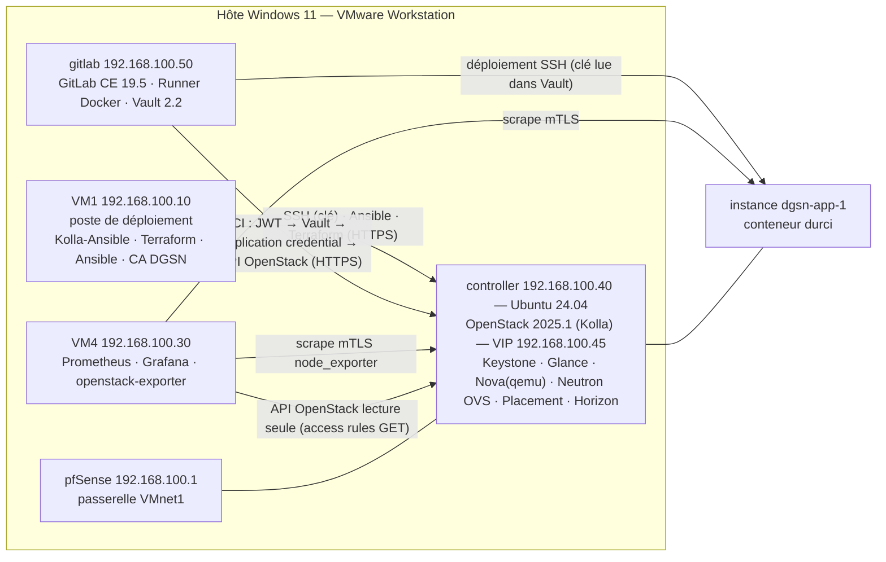
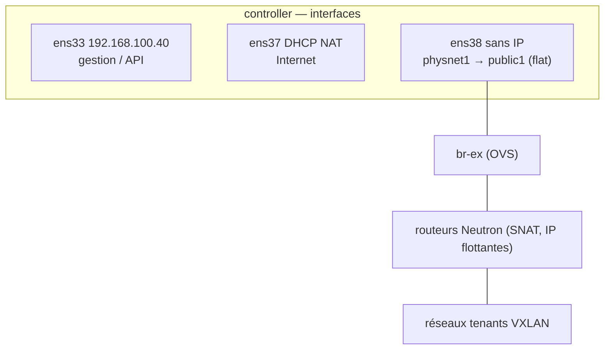
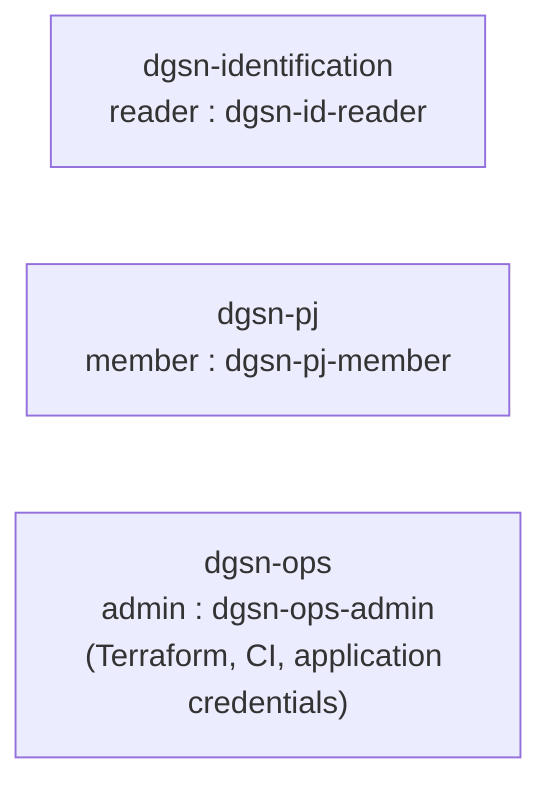
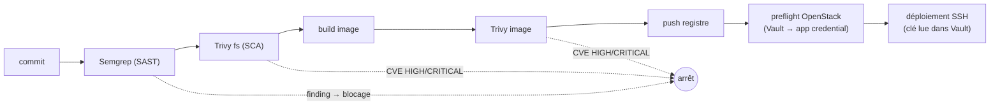

# Thème 11 — Cloud privé OpenStack sécurisé et chaîne DevSecOps pour la DGSN

**Rapport de réalisation et de tests — lab VMware**
Date : octobre 2026 — Version 1.0

---

## Sommaire
1. Introduction : contexte DGSN et problématique
2. Architecture réalisée
3. Choix technologiques et adaptations au lab
4. Mise en œuvre et résultats par phase (P1 à P9)
5. Tableau des métriques du sujet
6. Dimensionnement d'un cloud privé contraint
7. Sécurité : synthèse et incidents traités
8. Limites et écarts au sujet
9. Recommandations pour la DGSN en production
10. Conclusion
11. Vérification finale
- Annexes : scripts, preuves, reprise du lab

---

## 1. Introduction

### 1.1 Contexte
La Direction Générale de la Sûreté Nationale (DGSN) exploite des systèmes d'information sensibles : identification
(titres d'identité, biométrie), police judiciaire, exploitation opérationnelle. Ces systèmes exigent la
**souveraineté des données**, une **séparation stricte des périmètres**, la **traçabilité** des accès et une capacité
à livrer des applications rapidement sans dégrader la sécurité.

### 1.2 Problématique
Comment construire un **cloud privé** maîtrisé de bout en bout, qui :
- héberge des environnements cloisonnés par direction métier ;
- s'automatise entièrement (« Infrastructure as Code ») pour être reproductible et auditable ;
- intègre la sécurité **dans** la chaîne de livraison logicielle (DevSecOps : analyse de code, de dépendances et
  d'images avant tout déploiement) ;
- ne laisse **aucun secret** dans le code ni dans les pipelines ;
- est **supervisé**, **conforme** à un référentiel reconnu (CIS) et **résilient** ?

### 1.3 Démarche
Le projet a été réalisé et **testé** sur un lab VMware Workstation (hôte Windows 11, 32 Go de RAM), en dix phases
dont chacune n'est déclarée terminée qu'après un test d'acceptation consigné (`docs/journal.md`) avec ses preuves
(`docs/preuves/phaseN/`). Tout est sous forme de code dans le dépôt (`ansible/`, `kolla/`, `terraform/`, `gitlab/`,
`monitoring/`, `scripts/`).

---

## 2. Architecture réalisée

### 2.1 Vue d'ensemble

### 2.2 Réseaux

| Réseau | Plage | Rôle |
|---|---|---|
| VMnet1 (host-only) | 192.168.100.0/24 | gestion, API (VIP .45), réseau externe Neutron « public1 » (flat, IP flottantes .200–.230, passerelle pfSense .1) |
| VMnet8 (NAT) | 192.168.232.0/24 | accès Internet des VM (dépôts, images) |
| Réseaux tenants | VXLAN (10.40/24, 10.50/24, 10.80/24, 10.90/24…) | réseaux privés des projets, routés vers public1 |

### 2.3 Cloisonnement des projets (Keystone)

### 2.4 Chaîne DevSecOps

---

## 3. Choix technologiques et adaptations au lab

| Domaine | Choix | Justification |
|---|---|---|
| Cloud | **OpenStack 2025.1 Epoxy** via **Kolla-Ansible 20.6.0** (conteneurs) | Version maintenue et **SLURP** ; Kolla = déploiement reproductible, mises à niveau maîtrisées. 2024.1 abandonnée : fin de vie, images retirées (écart E1). |
| OS hôte OpenStack | Ubuntu 24.04 LTS | Seul Ubuntu supporté par Kolla 2025.1. |
| Topologie | **All-in-one** extensible (inventaire multinœud, ajout de compute2 = 1 ligne) | Contrainte RAM du lab (32 Go hôte). |
| Hyperviseur | Nova **qemu** (émulation) | VBS actif sur l'hôte Windows → pas de virtualisation imbriquée. |
| IaC | **Terraform** (provider openstack 3.x) + **Ansible** | Infrastructure déclarative + configuration idempotente. |
| CI/CD | **GitLab CE 19.5** + Runner Docker | Souverain (auto-hébergé), CI intégrée, registre d'images. |
| Sécurité CI | **Semgrep 1.181.0**, **Trivy 0.76.0** (versions épinglées) | SAST + SCA + scan d'image, blocage automatique. |
| Secrets | **HashiCorp Vault 2.2** (Raft, TLS, audit) + **JWT GitLab** | Aucun secret en variable CI ; accès limité à une branche protégée. |
| PKI | CA interne ECDSA (OpenSSL) | Chiffrement TLS de bout en bout sans dépendance externe. |
| Supervision | **Prometheus + Grafana** (VM4 existante), **openstack-exporter 1.7.0**, node_exporter **mTLS** | Standard ouvert, métriques plateforme + nœuds. |
| Conformité | **OpenSCAP** + **SCAP Security Guide 0.1.82**, profil **CIS niveau 1 serveur** (Debian 12) | Référentiel reconnu, remédiation Ansible officielle. |
| Résilience | **k3s** (au lieu de MicroK8s) | MicroK8s (snapd, ~540 Mo/nœud) ne tient pas sous qemu dans 10 Go ; k3s = binaire unique, mêmes API Kubernetes. |
| Images | Debian 12 genericcloud (SHA512 vérifié), cirros pour les tests | Légères ; Python présent pour Ansible. |

## 4. Mise en œuvre et résultats par phase

Chaque phase suit la même méthode : planifier, sécuriser (snapshot), construire en code, tester, corriger en boucle,
prouver (journal + preuves), mettre à jour l'état. Les commandes exactes sont dans `scripts/` ; les sorties dans
`docs/preuves/phaseN/`.

### P1 — Préparation du nœud controller — **PASS**
- Clone de VM1 personnalisé par `scripts/p1-controller.sh` (idempotent) : hostname, IP .40 statique (ens33), NAT en
  DHCP (ens37), 3ᵉ interface sans IP pour Neutron (ens38), cloud-init réseau désactivé, disque étendu
  (growpart + pvresize + lvextend : `/` à 116 Go), **nouveau machine-id et nouvelles clés hôte SSH**, sudo sans mot de passe.
- Puis migration Ubuntu 22.04 → **24.04.5** (`scripts/p2-upgrade-noble.sh`, non interactif, 11 min) exigée par
  Kolla 2025.1.
- Test `scripts/p1-test.sh` : **13/13 critères PASS**, rejoué après la migration (13/13). SSH par clé + sudo
  vérifiés sur controller, VM1 et VM4.
- Incidents corrigés : `lsblk -no PKNAME` renvoyant deux lignes (growpart en échec) → `lsblk -dno` ; fichier sudoers
  créé à l'amorçage avec de mauvais droits.

### P2 — OpenStack 2025.1 avec Kolla-Ansible — **PASS**
- Kolla-Ansible 20.6.0 dans un venv sur VM1 (ansible-core 2.17, compatible Python 3.10 de VM1), inventaire
  multinœud, `globals.yml` versionné, mots de passe générés sur VM1 uniquement.
- Déroulé : bootstrap-servers 44 s, prechecks 39 s, pull 306 s, **deploy 333 s** (407 tâches, 0 échec),
  post-deploy, `init-runonce` adapté (réseau externe 192.168.100.0/24, pool .200–.230).
- Test `scripts/p2-test.sh` : services Keystone/Glance/Nova/Neutron/Placement enregistrés, agents up, **Horizon
  HTTP 200**, réseau tenant **VXLAN** et externe **flat**, instance cirros **ACTIVE en 11–18 s**, **IP flottante
  pingable** depuis VM1, groupe de sécurité prouvé (ports 22/8080 ouverts, 8081 bloqué, puis ouvert après ajout de
  la règle : contre-preuve).
- Écarts : E1 (2025.1 au lieu de 2024.1), E2 (VM1 reste en 22.04 : exemption du contrôle d'OS pour le seul hôte de
  pilotage). Incidents : branche `stable/2024.1` supprimée, collections Ansible manquantes, prechecks NTP.

### P3 — Cloisonnement Keystone (RBAC) — **PASS**
- Projets `dgsn-identification`, `dgsn-pj`, `dgsn-ops` ; un utilisateur par rôle (reader, member, admin) ; mots de
  passe aléatoires stockés sur VM1 uniquement.
- Test `scripts/p3-test.sh` (7/7) : le **reader ne peut pas créer d'instance** — refus prouvé :
  `403 Policy doesn't allow os_compute_api:servers:create` — ni de réseau (403) ; le member travaille dans son projet
  mais ne peut ni accéder à `dgsn-identification` (401) ni lister les utilisateurs ; l'admin administre.

### P4 — Infrastructure as Code (Terraform + Ansible) — **PASS**
- `terraform/p4` : réseau 10.40.0.0/24 + routeur, **4 groupes de sécurité cloisonnés** (bastion, web, app, db),
  5 ports, **5 instances** Debian 12 avec cloud-init (durcissement SSH), 3 IP flottantes, inventaire et `ssh_config`
  Ansible générés. Accès SSH **uniquement via le bastion** (ProxyJump).
- `ansible/p4/site.yml` : bannière légale, durcissement SSH, sysctl réseau, services de démonstration confinés par
  systemd (DynamicUser, ProtectSystem=strict).
- **Mesures** : apply 23 s + Ansible 118 s = **141 s** ; après destroy (13 s), re-apply 34 s + 123 s = **157 s**
  (objectif < 600 s, marge ×3,8). Tests d'isolement à chaque apply (10/10) : SSH direct vers web refusé,
  web→app:8080 autorisé, bastion→app bloqué, web→db:5432 bloqué.
- Écart E3 : flavor réduite (1 vCPU / 512 Mo) ; atteinte après un travail de dimensionnement (section 6).

### P5 — GitLab CE et pipeline DevSecOps — **PASS**
- VM gitlab (4 Go + 4 Go de swap) clonée de VM1 puis **nettoyée des secrets hérités** (constat de sécurité) ;
  GitLab CE 19.5 en mode économe (Puma single, Sidekiq 5, supervision interne désactivée) installé en 289 s ;
  runner Docker (concurrence 1).
- Pipeline : Semgrep → Trivy fs → build → Trivy image → push registre → déploiement automatique sur une instance
  OpenStack (`dgsn-app-1`, Docker installé par cloud-init).
- **Application volontairement vulnérable (v1)** : pipeline **bloqué en 88 s par Semgrep** — 6 findings dont injection
  de commande (`subprocess` + `shell=True`, CWE-78) et désérialisation YAML (`yaml.load`, CWE-502) ; aucune étape
  suivante exécutée.
- **Version corrigée (v2)** : pipeline **réussi en 133 s** (objectif < 480 s) ; 0 finding, 0 CVE HIGH/CRITICAL
  (dépendances et image Alpine 3.24) ; application déployée, injection neutralisée (`/diag?host=127.0.0.1;id` → 400),
  conteneur durci (rootfs en lecture seule, `cap_drop=ALL`, `no-new-privileges`, utilisateur non root).
- Rapports Semgrep/Trivy sauvegardés (`docs/preuves/phase5/`).

### P6 — Vault, application credentials et TLS — **PASS**
- PKI interne (CA ECDSA P-384), certificats serveurs OpenStack et Vault.
- **TLS Kolla interne + externe** : `scripts/p6-tls-check.sh` 10/10 — TLS 1.3 vérifié sur Horizon, Keystone, Nova,
  Neutron, Glance, Placement et Vault ; HTTP clair et TLS 1.1 refusés ; 10/10 endpoints en https.
- **Vault** (Raft, HTTPS, audit) : application credential Keystone de la CI (rôle member, non « unrestricted »,
  30 j) et clé SSH de déploiement. La CI s'authentifie par **JWT GitLab** (rôle lié à `dgsn/demo-app` + `main`
  protégée, jeton 10 min) ; variable `DEPLOY_SSH_KEY` supprimée.
- **Pipeline Vault réussi en 56 s**, **0 secret** dans les journaux ; **refus prouvé** depuis une branche non protégée
  (`claim "ref" does not match`). Audit Vault : 2 connexions acceptées, 1 refusée.
- mTLS : voir section 7.

### P7 — Supervision Prometheus / Grafana — **PASS**
- Stack existante de VM4 conservée ; ajouts isolés et sauvegardés.
- **openstack-exporter 1.7.0** (SHA256 vérifié, écoute locale) avec une **application credential en lecture seule
  par access rules (GET uniquement)** — preuve : GET 200, POST réseau 401, POST serveur 401.
- **node_exporter en mTLS** sur controller et instance (certificat client Prometheus exigé ; sans certificat :
  handshake refusé).
- **Dashboard Grafana provisionné : 16 panneaux, 28 requêtes, 28/28 alimentées** (services OpenStack, agents,
  projets, instances, vCPU/RAM, IP flottantes, images, réseaux, Placement, CPU/mémoire/disque/réseau/charge de
  4 nœuds). Export : `monitoring/dgsn-dashboard.json` ; capture : `docs/preuves/phase7/08-dashboard-grafana.png`.

### P8 — Conformité CIS (OpenSCAP) et Fail2Ban — **PASS**
- 2 instances Debian 12 ; **SCAP Security Guide 0.1.82** (SHA512 vérifié), profil **CIS niveau 1 serveur**, scanner
  OpenSCAP 1.3 (celui d'Ubuntu 22.04, en 1.2, est trop ancien pour les datastreams récents).
- **Avant** : score XCCDF **67,90** — 223 règles conformes / 108 non conformes (**67,4 %**).
- **Remédiation Ansible** par le playbook officiel SSG (808 tâches, 1 709 s sous émulation). Le playbook officiel
  échouait sur des tâches inadaptées à l'environnement (exécution non root attendue, DNS externe transitoire, paquet
  `NetworkManager` inexistant sous Debian, service `named` absent) : approche retenue après 4 essais = **même
  playbook avec tolérance d'erreur par tâche**, chaque échec étant compté (10 par instance, tous des groupes système
  absents : gdm, sssd, syslog). Seule exclusion : la tâche *wireless* (bug du contenu SSG).
- **Après** : score **90,04** — 315 conformes / 31 non conformes (**91,0 %**, objectif > 85 % atteint) sur les 2 instances.
- Non-conformités restantes : 2 *high* → `no_empty_passwords_unix` **corrigée** par un complément Ansible (vérifiée
  *pass*) ; `grub2_password` **justifiée** (mot de passe GRUB = secret à injecter dans des images cloud démarrées sans
  interaction ; console contrôlée par Nova/Horizon). Les *medium* restantes concernent surtout PAM pour des comptes
  locaux non utilisés (authentification par clé), la journalisation distante (pas de collecteur dans le lab), la
  partition `/tmp` (non remédiable sur image cloud).
- **Fail2Ban** (jail sshd, backend systemd) : 5 tentatives depuis un attaquant simulé → **IP bannie**, port 22
  bloqué ; débannissement ; administration (liste blanche) intacte.
- Rapports HTML avant/après : `docs/preuves/phase8/scap-{1,2}-{avant,apres}-report.html`.

### P9 — Charge, résilience et restauration — **PASS**
- **Charge du plan de contrôle** : 8 instances créées en un seul appel (1,0 s) → **8/8 ACTIVE en 28 s**
  (17,1 instances/min), 0 erreur, suppression en 6 s.
- **Cluster k3s 3 nœuds** (1 serveur, 2 agents ; écart E8 : k3s au lieu de MicroK8s) : binaire vérifié SHA256,
  composants inutiles désactivés, **détection de panne accélérée** (grâce 10 s au lieu de 40 s, statut kubelet 2 s,
  tolérances de 5 s au lieu de 300 s). Application `whoami` 3 répliques (une par nœud), non root, rootfs en lecture
  seule, NodePort.
- **Charge applicative** (ab, 3 000 requêtes, 20 concurrents) : **127,8 req/s**, médiane 75 ms, p95 552 ms,
  0 erreur réelle.
- **Failover** : arrêt **brutal** d'un agent (`virsh destroy`, équivalent d'une coupure électrique), sonde HTTP
  horodatée toutes les 0,5 s : **1 seul échec sur 174 sondes, temps de reprise 1,7 s** (objectif < 30 s). Le nœud
  passe NotReady, le service continue sur 2 répliques ; la réplique de remplacement reste en attente à cause de la
  contrainte de répartition stricte (une par nœud) → en production : nœud de réserve ou `ScheduleAnyway`.
- **Restauration** : instance porteuse d'un fichier témoin → snapshot Glance (16 s, 1 Go) → suppression →
  restauration → témoin intact ; **RTO 61 s**.
- Incident traité : saturation du service de métadonnées (1 worker) lors de démarrages simultanés → **config drive**
  pour les instances du test (métadonnées sur disque local).

## 5. Tableau des métriques du sujet

| # | Métrique | Objectif | Mesuré | Statut |
|---|---|---|---|---|
| 1 | Terraform apply + configuration Ansible (5 instances) | < 10 min | **141 s** (re-apply 157 s) | ✅ |
| 2 | Pipeline DevSecOps complet | < 8 min | **133 s** (56 s avec Vault et caches) | ✅ |
| 3 | Conformité CIS après remédiation (2 instances) | > 85 % | **91,0 %** (67,4 % avant) | ✅ |
| 4 | Métriques temps réel dans Grafana | ≥ 10 | **28** (16 panneaux) | ✅ |
| 5 | Temps de reprise après arrêt d'un nœud | < 30 s | **1,7 s** | ✅ |

Détail, mesures complémentaires et preuves : `docs/tableau-metriques.md`.

### Statut des phases
| Phase | Statut | Preuve principale |
|---|---|---|
| P1 Préparation du controller | ✅ PASS | `preuves/phase1/03`, `05` |
| P2 OpenStack 2025.1 | ✅ PASS | `preuves/phase2/06-p2-test.txt` |
| P3 RBAC Keystone | ✅ PASS | `preuves/phase3/02-p3-test.txt` |
| P4 Terraform + Ansible | ✅ PASS | `preuves/phase4/43-*` |
| P5 GitLab DevSecOps | ✅ PASS | `preuves/phase5/10`, `20`, `21` |
| P6 Vault + TLS | ✅ PASS | `preuves/phase6/04`, `10`, `12` |
| P7 Supervision | ✅ PASS | `preuves/phase7/07`, `08` |
| P8 OpenSCAP CIS + Fail2Ban | ✅ PASS | `preuves/phase8/01`, `02`, rapports HTML |
| P9 Charge / résilience / restauration | ✅ PASS | `preuves/phase9/` |
| P10 Livrables + vérification finale | ✅ PASS | section 11, `preuves/verif-finale/` |

## 6. Dimensionnement d'un cloud privé contraint

Contexte : un seul nœud controller/compute de 12 Go et 8 vCPU, virtualisé sous VMware
sans virtualisation imbriquée (VBS actif sur l'hôte) → Nova en émulation qemu (TCG) :
la RAM des instances est réellement consommée et le CPU est émulé.

### Incident déclencheur (P4, essai 1)
- 5 instances Debian 12 de 512 Mo lancées par Terraform : la 5e échoue (Nova API 408 via haproxy).
- Controller à 435 Mo disponibles, hôte Windows sous le seuil de 3 Go.
- Cause : la plateforme seule consommait ~8,8 Go (33 conteneurs) avec les réglages Kolla par défaut.

### Optimisations et gains mesurés
Mesures avec `scripts/mem-measure.sh`, 3 min après stabilisation, sans instance.

| # | Optimisation | Défaut Kolla 2025.1 | Réglage DGSN lab |
|---|---|---|---|
| O1 | Workers API (`openstack_service_workers`) | min(vCPU, 5) = 5 | 1 |
| O2 | Workers RPC (`openstack_service_rpc_workers`) | min(vCPU, 3) = 3 | 1 |
| O3 | Heat (orchestration) | activé | désactivé (Terraform le remplace) |
| O4 | fluentd (collecte de logs) | activé | désactivé (logs en fichiers ; supervision en P7) |
| O5 | MariaDB `innodb_buffer_pool_size` | 40 % de la RAM ≈ 4,7 Go | 256 Mo (kolla/config/galera.cnf) |
| O6 | memcached `-m` | 256 Mo | 128 Mo |

| Mesure | Avant (O1–O6) | Après | Gain |
|---|---|---|---|
| Conteneurs | 33 | 29 | −4 |
| Mémoire des conteneurs | 7 248 Mo | 4 114 Mo | **−3 134 Mo (−43 %)** |
| RAM disponible controller | 3 748 Mo | 7 505 Mo | **+3 757 Mo (×2)** |

Preuves : docs/preuves/phase4/10-mem-avant-allegement.txt, 12-mem-apres-allegement.txt.

### Non-régression
- P3 (RBAC) : 7/7 PASS après allègement.
- P2 : voir journal (test rendu autonome : instance cirros recréée à chaque exécution).

### KSM (déduplication mémoire des instances)
- Activé sur controller (ansible/ksm.yml) : pages_to_scan 1000, sleep 50 ms.
- 5 instances Debian 12 identiques (512 Mo) : **716 à 884 Mo économisés** en ~2 min (≈ 30 % de la RAM des invités).

### Budget mémoire de l'hôte (31,4 Go)
| Poste | Initial | Après optimisations |
|---|---|---|
| controller (memsize) | 12 288 Mo (processus VMware jusqu'à 14,6 Go) | **10 240 Mo** |
| pfSense | 3 104 Mo | **1 536 Mo** |
| VM4 (Prometheus/Grafana) | 4 096 Mo | suspendue jusqu'à P7 |
| VM1 (déploiement) | 4 096 Mo | **2 048 Mo** |
| Total VM allumées | 23,6 Go | **13,8 Go** (+ gitlab 4 Go en P5) |
| Empreinte hôte du processus VMware du controller | jusqu'à 14,6 Go (invité 12 Go) | 7,8 Go au démarrage, jusqu'à ~14,9 Go après pics d'instances (invité 10 Go, cache de fichiers inclus) |

Constat : VMware ne rend pas à l'hôte la mémoire libérée dans l'invité (pas de pression → pas de ballooning) ;
après un pic, seul un redémarrage de la VM ramène son empreinte au niveau de la charge réelle.

### Enseignements pour la DGSN (production)
- Les valeurs par défaut de Kolla visent des serveurs physiques (≥ 64 Go) : en production, garder plusieurs
  workers par API sur des contrôleurs dédiés (3 nœuds HA), séparés des computes.
- Ne jamais co-localiser contrôle et calcul sur un nœud contraint : la contention mémoire dégrade
  d'abord les API (408/503), donc la disponibilité du service.
- Dimensionner le buffer pool MariaDB sur la taille réelle des bases, pas sur la RAM de l'hôte
  quand des instances partagent le nœud.
- Réserver explicitement la mémoire de l'hôte (`reserved_host_memory_mb`) pour que Placement
  n'ordonnance pas d'instance dans la RAM des services.

## 7. Sécurité : synthèse et incidents traités

### 7.1 Mesures en place (défense en profondeur)
| Couche | Mesure | Preuve |
|---|---|---|
| Identité | Projets cloisonnés, rôles reader/member/admin, application credentials limitées (rôle member, non « unrestricted », expiration ; supervision : access rules GET-only) | P3, P6, P7 |
| Réseau | Groupes de sécurité au moindre privilège (bastion obligatoire, flux nommés web→app→db), nftables (CIS) sur les instances, réseaux tenants VXLAN isolés | P2, P4, P8 |
| Chiffrement | TLS 1.3 sur toutes les API OpenStack et Vault (CA interne), **mTLS** Prometheus → node_exporter | P6, P7 |
| Secrets | Vault (Raft, audit, TLS), CI par JWT lié à une branche protégée, 0 secret en variable CI ni dans les journaux | P6 |
| Chaîne logicielle | SAST (Semgrep), SCA (Trivy fs), scan d'image (Trivy), outils épinglés, dépôts APT signés, archives vérifiées (SHA256/SHA512) | P5, P7, P8 |
| Exécution | Conteneur non root, rootfs en lecture seule, `cap_drop=ALL`, `no-new-privileges` ; services systemd confinés | P4, P5 |
| Systèmes | Durcissement SSH (clés uniquement, root interdit), CIS niveau 1 (OpenSCAP), Fail2Ban | P1, P4, P8 |
| Traçabilité | Journal d'audit Vault (valeurs hachées HMAC), journaux de pipelines, `docs/journal.md` horodaté | P6 |

### 7.2 Part de mTLS réalisée
| Flux | État |
|---|---|
| Prometheus → node_exporter (controller, instances) | **mTLS exigé** (`RequireAndVerifyClientCert`, certificat client DGSN) |
| Administration → Vault | certificat client DGSN vérifié s'il est présenté (non exigé) |
| Clients/CI → API OpenStack, CI → Vault | TLS serveur + authentification forte (jeton Keystone, JWT signé) |
| haproxy → services OpenStack, RabbitMQ, MariaDB | non chiffrés (réseau de gestion isolé) — **perspective** |

### 7.3 Incidents de sécurité détectés et corrigés pendant le projet
1. **Fuite d'un jeton de runner** dans une sortie de commande (`gitlab-runner list`) : jeton masqué dans les
   preuves, **runner révoqué et recréé** (jeton exposé invalidé), scripts corrigés pour masquer systématiquement.
2. **Secrets hérités par clonage** : la VM gitlab, clonée du poste d'administration, contenait les mots de passe
   Kolla, les identifiants OpenStack et la clé SSH d'administration (accès sudo au controller). Supprimés et
   vérifiés ; un exporter en clair hérité a aussi été désactivé sur le controller.
3. **Mot de passe des VM communiqué en clair** dans la conversation de travail : non utilisé par l'automatisation
   (amorçage manuel par l'utilisateur) ; **changement recommandé**.

## 8. Limites et écarts au sujet

| # | Écart | Cause | Impact | Alternative DGSN |
|---|---|---|---|---|
| E1 | OpenStack **2025.1** au lieu de 2024.1 | 2024.1 en fin de vie, images retirées | positif (version maintenue) | rester sur les versions SLURP maintenues |
| E2 | VM1 (pilotage) en Ubuntu 22.04 | 2025.1 n'exige noble que sur les nœuds OpenStack | aucun | poste de déploiement 24.04 dédié et durci |
| E3 | Instances **réduites** (512 Mo–1 Go, 1 vCPU) | nœud unique 10 Go, qemu sans accélération | performances non représentatives | computes physiques KVM |
| E4 | **All-in-one** (contrôle + calcul sur un nœud) | RAM du lab | pas de HA du plan de contrôle | 3 contrôleurs HA + computes |
| E5 | Nova en **qemu** (émulation) | VBS actif sur l'hôte | lenteur (démarrages, scans) | KVM matériel |
| E6 | Allègement Kolla (1 worker, Heat/fluentd désactivés) | RAM | débit API limité (latence 5–19 ms mesurée) | workers par défaut sur contrôleurs dédiés |
| E7 | Vault nœud unique, descellement 1/1 local | lab | pas de HA, clé sur le serveur | cluster Raft 3/5 nœuds, Shamir 3/5 ou auto-unseal HSM |
| E8 | **k3s** au lieu de MicroK8s | empreinte mémoire | aucun sur l'objectif (API Kubernetes identiques) | k3s/RKE2 ou Kubernetes managé interne |
| E9 | Registre GitLab et GitLab en HTTP | TLS concentré sur OpenStack/Vault | flux CI en clair sur le réseau de gestion | TLS GitLab + registre (CA DGSN) |
| E10 | Lab exécuté par groupes de VM | RAM de l'hôte (31,4 Go) | vérification finale séquentielle | infrastructure dimensionnée |

Les mesures de temps (P4, P5, P9) sont obtenues **malgré** l'émulation qemu : sur du matériel avec KVM, elles
seraient nettement meilleures.

## 9. Recommandations pour la DGSN en production

1. **Haute disponibilité** : 3 nœuds de contrôle (Galera/RabbitMQ en quorum, haproxy/keepalived), computes séparés,
   réseau de gestion, de stockage et de tenants physiquement séparés.
2. **Stockage** : **Ceph** (RBD pour Cinder/Glance/Nova éphémère), réplication ×3, chiffrement au repos.
3. **PRA multi-site** : second site actif/passif, réplication Ceph (rbd-mirror), sauvegardes externalisées
   chiffrées, tests de restauration planifiés (RTO/RPO mesurés comme en P9).
4. **mTLS généralisé** : `kolla_enable_tls_backend`, TLS RabbitMQ/MariaDB, certificats courts émis par Vault PKI,
   rotation automatique ; maillage de services pour les applications.
5. **Secrets** : Vault en cluster, auto-unseal HSM, révocation du jeton root, rotation automatique des application
   credentials, politiques par projet métier.
6. **Identité** : fédération Keystone avec l'annuaire DGSN (LDAP/SAML/OIDC), MFA pour Horizon, rôles revus
   périodiquement, comptes de service par application credentials uniquement.
7. **Conformité continue** : scans OpenSCAP planifiés (CIS niveau 2 / ANSSI BP-28 « renforcé »), remédiation par
   Ansible en CI, images de référence durcies (golden images) au lieu du clonage.
8. **Chaîne logicielle** : SBOM et signature des images (cosign), politique d'admission (images signées seulement),
   miroirs internes des dépôts et registres (pas de dépendance directe à Internet).
9. **Supervision et SOC** : alerting (Alertmanager), centralisation des journaux (OpenSearch), corrélation SIEM,
   métriques de sécurité (échecs d'authentification, refus Vault, bannissements Fail2Ban).
10. **Exploitation** : mises à niveau SLURP annuelles testées en préproduction, capacity planning (le lab a montré
    que les réglages par défaut supposent des serveurs ≥ 64 Go).

## 10. Conclusion

Le Thème 11 a été **réalisé et testé de bout en bout** sur un lab volontairement contraint : un cloud privé
OpenStack 2025.1 chiffré, cloisonné par direction métier, entièrement décrit en code, alimenté par une chaîne
DevSecOps qui **bloque** le code vulnérable et ne manipule **aucun secret** en clair, supervisé, conforme au CIS
à 91 % et capable de survivre à la perte brutale d'un nœud en moins de 2 secondes.

Les **cinq métriques du sujet sont atteintes**, avec des marges importantes malgré l'émulation qemu. Les écarts
(version 2025.1, all-in-one, instances réduites, k3s, Vault mono-nœud) sont tous **assumés, mesurés et justifiés**,
et chacun s'accompagne d'une recommandation pour la production.

Au-delà des chiffres, le projet a mis en évidence des enseignements directement utiles à la DGSN :
- la sécurité se **vérifie** (tests de refus, audits, scans) plutôt qu'elle ne se déclare ;
- les incidents réels rencontrés (jeton exposé, secrets hérités par clonage, service saturé) montrent l'intérêt
  de l'automatisation, de la traçabilité et des images de référence ;
- un cloud privé souverain se **dimensionne** : les réglages par défaut supposent des serveurs dédiés, et
  l'ingénierie de capacité fait partie de la sécurité (disponibilité).

## 11. Vérification finale (par groupes de VM)

La RAM de l'hôte (31,4 Go) ne permettant pas d'allumer toutes les VM simultanément, la vérification finale a été
réalisée **par groupes**, chaque groupe après un **arrêt/démarrage complet** des VM concernées, en rejouant un test
court de chaque phase (scripts/verif-finale-*, preuves dans docs/preuves/verif-finale/).

| Groupe | VM allumées | Redémarrage | Tests rejoués | Résultat |
|---|---|---|---|---|
| A — socle | pfSense, controller, VM1 | controller + VM1 (arrêt propre 100 s, OpenStack prêt en 77 s) | P1 (13/13), P2, P3, P6 TLS OpenStack, P4 (apply + Ansible **136 s**), P8 (score de référence **reproduit : 67,90**), P9 (rafale 8/8 en 33 s) | ✅ PASS |
| B — DevSecOps | socle + gitlab | gitlab (Vault **scellé** après redémarrage → descellé) | P5 + P6 : **pipeline complet réussi en 52 s** (Vault, application credential, déploiement), **0 secret** dans les journaux, TLS Vault vérifié (**10/10** au total) | ✅ PASS |
| C — supervision | socle + VM4 (gitlab suspendue) | VM4 | P7 : services actifs, 3 cibles DGSN *up* (dont 2 en mTLS), dashboard **28/28** requêtes alimentées | ✅ PASS |

Écarts constatés pendant la vérification et corrigés (outillage, pas plateforme) : critère d'IP de P1 à adapter à la
VIP keepalived posée par Kolla ; faux positif du script d'audit des secrets quand Vault est scellé (garde-fou
ajouté) ; arrêt de GitLab plus long que prévu (contrôles refaits après le redémarrage effectif).

**Toutes les phases P1 à P9 sont revalidées depuis un état redémarré.**

## Annexes
- **A. Journal horodaté** de toutes les opérations et tests : `docs/journal.md`.
- **B. Preuves** par phase : `docs/preuves/phase1` à `phase9` (sorties de commandes, rapports HTML OpenSCAP, rapports
  Semgrep/Trivy, export et capture Grafana, sondes CSV du failover).
- **C. Code** : `kolla/` (globals, inventaire, certificats publics), `terraform/` (p4, p5, p8, p9), `ansible/`
  (p4, p8, p9, KSM), `gitlab/` (gitlab.rb, application, pipeline, Vault), `monitoring/`, `scripts/`.
- **D. Reprise du lab** : `docs/guide-reprise.md` ; **démonstration** : `docs/demo.md`.
- **E. Notes détaillées** : `docs/rapport-notes/` (écarts, dimensionnement, sécurité P6).

